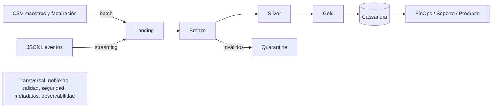

# Documento de diseño · Primera entrega

Minería de Datos II · ISTEA · 2C 2026

## 1. Problema

Ingestar, limpiar y publicar datos de clientes para **FinOps** (costos), **Soporte** (tickets y SLA) y **Producto** (uso).
- Eventos en casi tiempo real.
- Maestros y facturación en batch.

> [!TIP]
> **Necesidad analítica por usuario** (consigna 2.3)
> - **FinOps:** costos, consumo, revenue, créditos, impuestos, anomalías y eficiencia por organización y servicio.
> - **Soporte:** volumen de tickets, severidad, cumplimiento de SLA y CSAT por organización y fecha.
> - **Producto / Usage:** uso de servicios, requests, métricas operativas, tokens GenAI y carbono cuando estén disponibles.

> [!TIP]
> **Criterios de éxito de esta etapa** (consigna 5.4)
> - El problema, los usuarios y los criterios de éxito están formulados sin ambigüedad.
> - La arquitectura responde a los requisitos y distingue claramente batch y streaming.
> - Las zonas del Data Lake, formatos y particiones son coherentes con los datos provistos.
> - El flujo MapReduce o equivalente muestra cómo se resolvería el procesamiento batch del caso.
> - Los supuestos y riesgos son realistas y tienen mitigaciones propuestas.
> - El repositorio y la documentación permiten continuar la implementación sin rehacer la fundación.

## 2. Las 5V

| V | Evidencia |
|---|---|
| Volumen | 43.200 eventos, 80 organizaciones, 60 días |
| Velocidad | 120 archivos JSONL (micro-lotes) |
| Variedad | CSV y JSONL, 8 fuentes, esquema v1 y v2 |
| Veracidad | nulos, `value` como texto, 216 costos negativos, 3 monedas |
| Valor | control de costos, SLA y uso |
## 3. Inventario de fuentes

> [!TIP]
> Corrección 4 de la devolución: grano, clave, trazabilidad y riesgos por fuente.

- customers_orgs: 1 fila = organización · clave org_id · 80 filas · 11 nps_score nulos
- users: 1 fila = usuario · clave user_id · 800 filas · 139 last_login nulos
- resources: 1 fila = recurso · clave resource_id · 400 filas · 83 tags_json nulos
- support_tickets: 1 fila = ticket · clave ticket_id · 1.000 filas · 240 resolved_at y 254 csat nulos
- marketing_touches: 1 fila = interacción · clave touch_id · 1.500 filas · sin nulos
- nps_surveys: 1 fila = encuesta · clave org_id + survey_date · 92 filas · 19 nps_score nulos
- billing_monthly: 1 fila = factura · clave invoice_id · 240 filas · 3 monedas y 13 subtotales negativos
- usage_events: 1 fila = evento · clave event_id · 43.200 filas · value como texto, 2.038 unit nulos y 211 costos < -0,01

Trazabilidad: en Bronze cada fila lleva ingest_ts y source_file (consigna 4.2).

> [!TIP]
> Corrección 1 de la devolución: responsabilidades, quarantine, capacidades transversales y justificación de Lambda.

## 4. Arquitectura

Responsabilidades:

Landing (consigna 4.2): archivos originales. No modificar.

Bronze (consigna 4.2): mismo grano de la fuente, tipificación explícita, deduplicación cuando corresponda y columnas técnicas ingest_ts y source_file.

Silver (consigna 4.2): normalización, joins, tratamiento de nulos y outliers, compatibilización de versiones de esquema y SCD cuando aplique.

Quarantine (consigna 4.4): separación o bloqueo de registros inválidos y quarantine en Parquet.

Gold (consigna 4.2): tablas o vistas orientadas a FinOps, Soporte y Producto/Usage, preparadas para servir en Cassandra/AstraDB.

Capacidades transversales (consigna 4.1): gobierno, calidad, seguridad, metadatos y observabilidad.

Por qué Lambda (consigna 4.3): batch para maestros, facturación y encuestas; streaming para usage_events_stream con ventanas, watermarks e idempotencia.

Casi tiempo real para métricas de uso, consumo y costos incrementales; batch diario o mensual para maestros, facturación y fuentes de referencia (consigna 2.1). Los eventos llegan fragmentados para simular micro-lotes (consigna 3.1).

> [!TIP]
> Corrección 2: naming, retención, metadatos, promoción y particiones.

## 5. Data Lake

Zonas: Landing, Bronze, Silver, Gold y Quarantine; Parquet desde Bronze (consigna 4.2).

Naming: datalake/zona/fuente.

Particiones: por fecha, porque las consultas usan rangos de fechas (consigna 7.4) y por servicio quedarían archivos chicos (Clase 03).

Retención: todo el histórico; Landing no se borra (consigna 3.2).

Metadatos: ingest_ts y source_file (consigna 4.2).

Promoción: a Silver solo pasan los válidos; el resto va a Quarantine (consigna 6.2).
## 6. Flujo batch con MapReduce

**Objetivo:** costo diario por organización y servicio.

| Etapa | Qué hace |
|---|---|
| Map | por cada evento → clave `(org_id, fecha, service)`, valor `cost_usd_increment` |
| Shuffle | junta todos los eventos con la misma clave |
| Reduce | suma los costos de cada clave |
| Salida | `org_daily_usage_by_service` en Gold |

En Spark: `groupBy("org_id", "fecha", "service").agg(sum("cost_usd_increment"))`

## 7. Matriz requisito-componente

| Requisito | Componente |
|---|---|
| Ingesta batch | PySpark → Bronze |
| Ingesta streaming | Structured Streaming → Bronze |
| Calidad | reglas + Quarantine |
| Limpieza y v1/v2 | Silver |
| Marts por área | Gold |
| Consultas | Cassandra |

> [!TIP]
> Corrección 5: horas, responsables y riesgos.

## 8. Riesgos

value llega como texto → convertir a número (cast).

211 costos menores a -0,01 → Quarantine.

2.038 eventos con unit vacío y value → Quarantine.

3 monedas en facturación → convertir con exchange_rate_to_usd.

Cambio de esquema v1 / v2 → esquema explícito con carbon_kg y genai_tokens.

Falla de AstraDB o de conexión → plan alternativo con capturas y salidas guardadas (consigna 8.4).

## 9. Plan y esfuerzo

Responsable: Leandro Lencina.

Recursos: Google Colab, PySpark, GitHub y Cassandra en DataStax Astra DB.

Horas usadas: primera entrega 6 h · correcciones 3 h.

Horas planificadas: 2 h semanales (consigna): 6 h hasta el 18/11 y 6 h hasta el 09/12.
