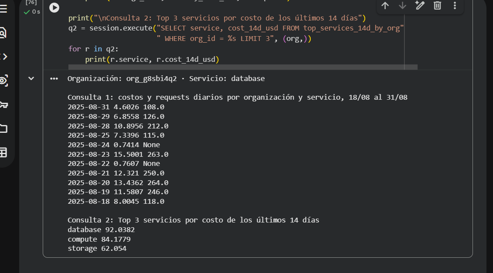

# Evidencias

> [!TIP]
> Corrección 6: evidencias estructuradas (consigna 8.1).

Notebook: notebooks/01_exploracion_landing.ipynb

Fuentes: 8, con clave verificada (filas = únicas).

Eventos: 43.200 · v1 10.800 · v2 32.400.

Calidad: 211 costos < -0,01 · 2.038 unit vacíos con value · 0 event_id repetidos.

Volumen: 720 eventos por día · 120 por día y servicio.

Facturación: USD 160 · ARS 51 · EUR 29 · 13 subtotales negativos.

## Segunda entrega (notebook 02)

Bronze eventos: 43.200 · al repetir la carga: 43.200 (sin duplicados).

Silver: 40.956 · Quarantine: 2.244 · total 43.200.

Quarantine por motivo: costo_negativo 211 · unit_vacio 2.033 (consulta quarantine_usage_events).

Maestros en Bronze: customers_orgs 80 · users 800 · billing_monthly 240.

Silver billing: 240.

Gold org_daily_usage_by_service: 11.050 filas.

## Rutas del Data Lake

Landing: /content/proyecto/datalake/landing

Bronze: /content/proyecto/datalake/bronze/usage_events · customers_orgs · users · billing_monthly

Silver: /content/proyecto/datalake/silver/usage_events · billing_monthly

Quarantine: /content/proyecto/datalake/quarantine/usage_events

Gold: /content/proyecto/datalake/gold/org_daily_usage_by_service

Checkpoints: /content/proyecto/checkpoints/

## Muestras de Quarantine

```
event_id          cost_usd_increment  value    unit      motivo
evt_ls602epdij1k  0.0612              3.0463   NULL      unit_vacio
evt_4u08mhaeqytm  0.0000              0.0      NULL      unit_vacio
evt_z2csvu281t4y  1.7901              121.0    NULL      unit_vacio
evt_pmlgsgb29mur  -7.9514             129.0    count     costo_negativo
evt_9y3nrmfky3lu  -0.8771             10.5777  gb_hours  costo_negativo
evt_fac9pru3xlpd  -0.5116             10.3166  gb_hours  costo_negativo
```
## Serving en Astra DB (Cassandra)

Base mineria_datos_ii · Serverless (non-vector) · AWS us-east-2 · keyspace proyecto_integrador.

Tabla org_daily_usage_by_service: 11.050 filas cargadas (todo el Gold).

Tabla top_services_14d_by_org: 262 filas (organización y servicio con uso del 18/08 al 31/08/2025).

Control cruzado: org_g8sbi4q2 · database suma 92,0382 en la consulta 1 y en la consulta 2.

```
CONSULTA 1
SELECT usage_date, daily_cost_usd, requests FROM org_daily_usage_by_service
 WHERE org_id = 'org_g8sbi4q2' AND service = 'database'
   AND usage_date >= '2025-08-18' AND usage_date <= '2025-08-31';

CONSULTA 2
SELECT service, cost_14d_usd FROM top_services_14d_by_org
 WHERE org_id = 'org_g8sbi4q2' LIMIT 3;
-- database 92.0382 · compute 84.1779 · storage 62.054
```


